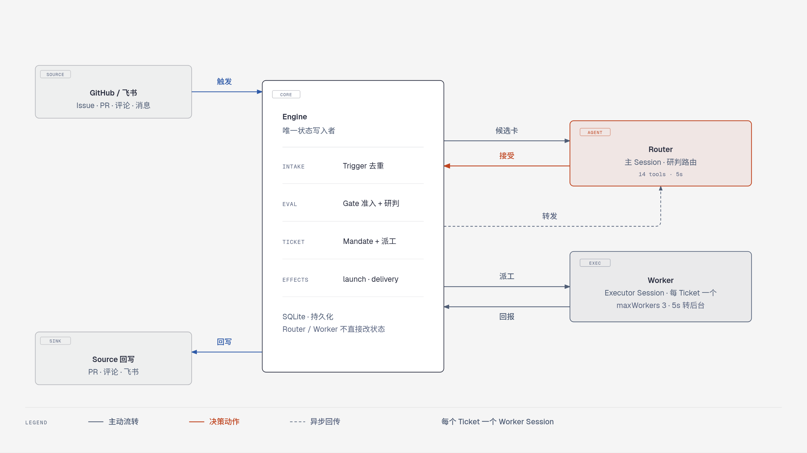
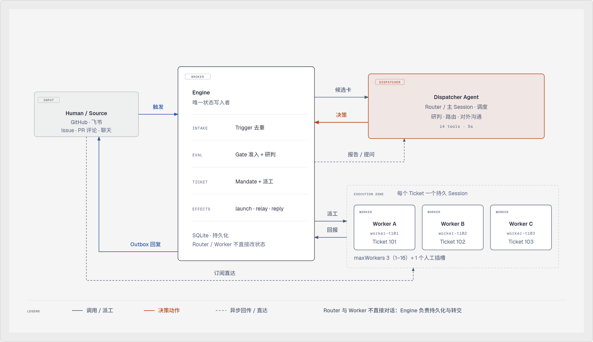
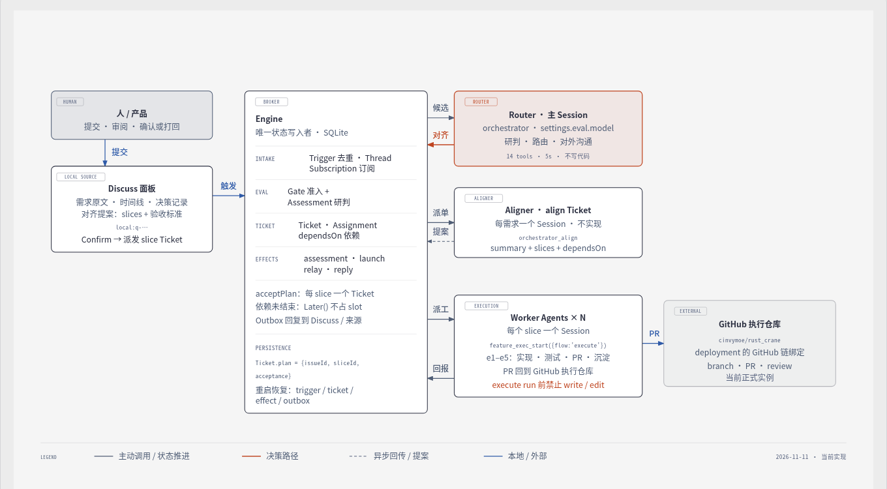
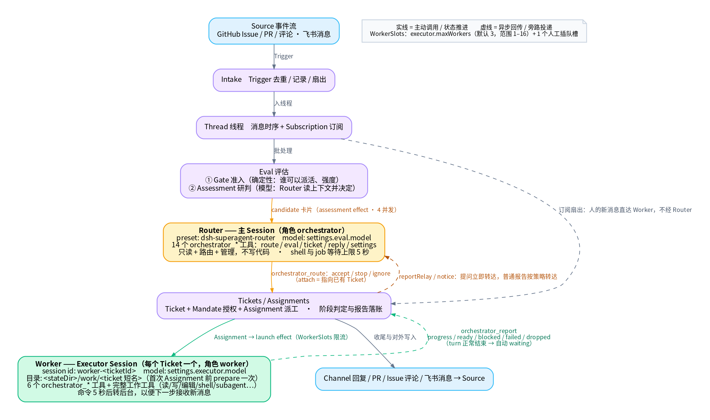
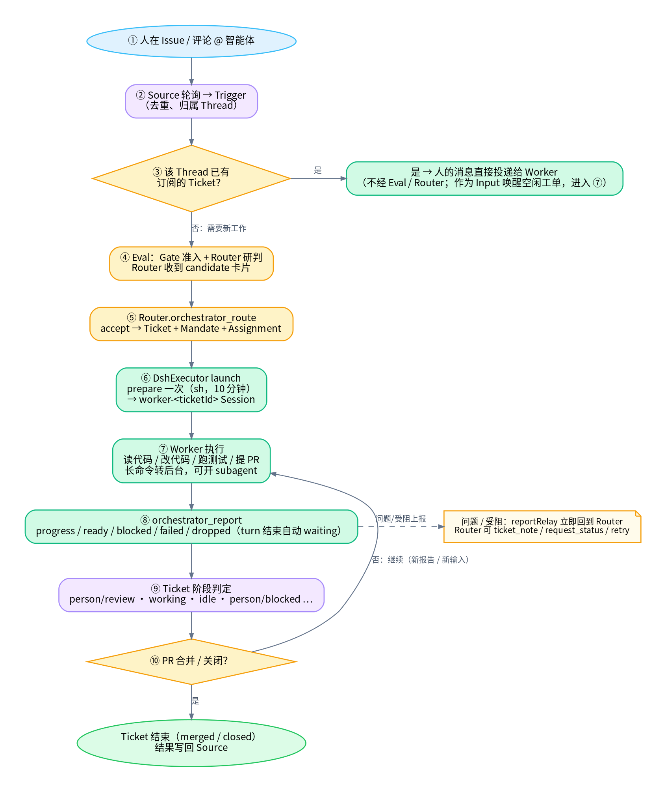
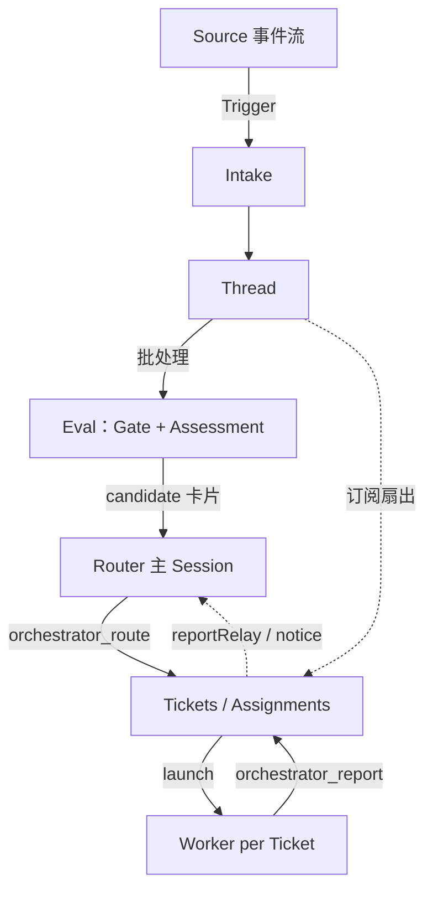

# Router / Worker 设计图

> 对应源码版本：`/data/project/dsh-superagent`（截至 2026-11-06，含工作区中未提交的多链路改动）。
> Router 在代码与提示词里叫 **主 Session / `orchestrator`**；Worker 叫 **Executor Session / `worker`**。

## 图 0：编辑版总览（2026-11-10 重设计）

- 单文件 HTML：[`router-worker-architecture.html`](./router-worker-architecture.html)（内联 SVG，可直接浏览器打开）。
- 阅读方式：Source → Engine → Router → Engine → Worker → Engine → Source 回写；Router 只研判与路由，Worker 每 Ticket 一个，Engine 是唯一状态写入者。
- 图例：实线为主动流转，coral 为决策动作，虚线为异步回传（reportRelay / notice）。
- 画布：`doc-wide` 1280×720；整体版式与三张角色卡片在同一页。

## 图 0b：Agent 协作拓扑（调度 Agent 与 Worker）

- 单文件 HTML：[`agent-dispatch-worker.html`](./agent-dispatch-worker.html)（内联 SVG + 三张角色卡片）。
- 视角：Dispatcher Agent（Router / 主 Session）在右上，Worker Agents 在右下，Engine 在中间做唯一中转与账本；两者不直接对话。
- 读法：Source → Engine → Dispatcher 决策 → Engine 派工 → Worker → Engine 回报/转提问 → Dispatcher 回复 → Source；已订阅 Thread 的人消息由 Engine 绕过 Router 直达 Worker。
- 画布：`doc-wide` 1280×720；图例：实线调用/派工，coral 决策动作，虚线异步回传/直达。

## 图 0c：当前架构与角色（2026-11-11）

- 单文件 HTML：[`current-architecture.html`](./current-architecture.html)（内联 SVG + 角色卡 + 角色矩阵 + 实例绑定表）。
- 当前完整链路：Discuss 面板提交需求 → `local` Source 触发 → Router 以 `mode='align'` 接单 → Aligner 提案 slices/验收标准 → 人在面板确认 → Engine `acceptPlan` 每 slice 建一个 Ticket → Worker 先 `feature_exec_start({flow:'execute'})` 再走 e1–e5 → PR 回到 deployment 绑定的 GitHub 仓库。
- 角色：Human（Discuss 审阅/确认）、Router（主 Session，研判路由）、Aligner（align Ticket，只提案）、Worker（work Ticket，执行）、Engine（唯一状态写入者）。
- 注意：本地 issue 目前没有仓库字段，执行仓库来自 deployment 的默认 GitHub 链；页面底部的实例表记录当前正式/测试绑定。
- 这是当前实现的权威总览；图 0 / 0b 保留为早期 Router/Worker 视角。

## 图 1：总体架构与数据流

- **Router（主 Session）**：常驻单实例，preset `dsh-superagent-router`，模型 `settings.eval.model`。只负责研判、路由、工单管理与对外沟通；没有文件写入工具，shell 与 job 等待上限 5 秒。
- **Worker（Executor Session）**：每个 Ticket 一个，Session id `worker-<ticketId>`，preset `dsh-superagent-worker`，模型 `settings.executor.model`。独立目录 `<stateDir>/work/<ticket 短名>`，拥有完整工作工具，可开 subagent。
- **Engine**：唯一状态写入者（SQLite Store）。Router 与 Worker 不直接对话，所有状态变更通过 Engine 的领域命令与 `Effects` 持久队列完成。

## 图 2：一张工单的生命周期

1. 人在 Issue / PR / 评论中 @ 智能体。
2. Source 轮询产生 `Trigger`，按 Thread 去重。
3. 若该 Thread 已有订阅的 Ticket：人的消息直接投递给 Worker（作为 Input，可唤醒空闲工单），**不经过 Router**。否则进入 Eval。
4. Eval = `Gate`（确定性准入）+ `Assessment`（Router 研判）。Router 收到 `candidate` 卡片。
5. `orchestrator_route` 的 `accept` 原子创建 `Ticket + Mandate + Assignment`。
6. `launch` effect 执行 `prepare`（一次，`sh`，10 分钟）并启动/唤醒 `worker-<ticketId>` Session。
7. Worker 在工单目录内工作、提 PR；前台命令 5 秒后转后台，便于下一步接收消息。
8. Worker 调 `orchestrator_report` 上报 `progress / ready / blocked / failed / dropped`；turn 正常结束由 Executor 自动记 `waiting`。
9. `Ticket` 阶段由 `src/core/stage.ts` 判定，如 `person/review`、`working`、`idle`、`person/blocked`。
10. PR 合并/关闭后 Ticket 结束（`merged` / `closed`），结果经 Channel 写回 Source。

## 角色对比

| 维度 | Router（主 Session） | Worker（Executor Session） |
| --- | --- | --- |
| 角色名 | `orchestrator` | `worker` |
| 生命周期 | 进程级常驻，一个实例一个主 Session | 每个 Ticket 一个，Ticket 结束即停 |
| Preset | `dsh-superagent-router` | `dsh-superagent-worker` |
| 模型 | `settings.eval.model` | `settings.executor.model` |
| 工具 | 14 个 `orchestrator_*` + 只读 DSH 工具（`skill/bash/read/read_image/job_*`） | 6 个 `orchestrator_*` + 完整工作工具（读写文件、shell、web、skill、todo、subagent 等） |
| 写入权限 | 无文件写/编辑；只改领域状态与配置 | 可读写工单目录、跑命令、提 PR |
| 等待策略 | shell 与 job 等待 ≤ 5 秒，禁止 `sleep` 轮询 | shell 5 秒后转后台；后台任务/子代理最多 30 分钟 |
| 并发 | 单 Session 串行处理候选卡与消息 | `executor.maxWorkers`（默认 3，范围 1–16）+ 1 个人工插队槽 |
| 主要输出 | `orchestrator_route`、`orchestrator_eval_decide`、`orchestrator_reply` 等 | `orchestrator_report`、PR、Channel 回复 |

## 关键代码位置

- `src/app/sessions.ts:48`：`WORKER_PRESET` / `ROUTER_PRESET` 常量
- `src/app/sessions.ts:150`：`initializeRoleModel(ctx, result.agent, role === 'orchestrator' ? settings.eval.model : settings.executor.model)`
- `src/app/sessions.ts:263`：主 Session 工具白名单 `['skill','bash','read','read_image','job_output','job_list','job_kill']`
- `src/app/sessions.ts:61`：`WORK_TOOLS`（Worker 工作工具集合）
- `src/app/tools/main.ts:127`：`orchestrator_route`（1–20 项，逐项执行）
- `src/app/tools/executor.ts:75`：`orchestrator_report`
- `src/executor/dsh.ts:24`：`workerSessionId = (ticketId) => \`worker-${ticketId}\``
- `src/executor/dsh.ts:177`：`WorkerSlots`
- `docs/003-execution.md:23-29`：Executor 与主 Session 的 preset / 等待限制说明
- `docs/007-architecture.md:491-533`：工具清单与预设说明

## Mermaid 源（与图 1 等价）

