# dsh-superagent 设计图

> 对应源码版本：`/data/project/dsh-superagent`（截至 2026-11-15，含工作区中未提交的 agents / capabilities 改动）。
> Router 在代码与提示词里叫 **主 Session / `orchestrator`**；Worker 叫 **Executor Session / `worker`**。

## 文档 → 图（先看这张表）

| 文档 | 图 | 讲什么 |
| --- | --- | --- |
| [007 架构总览](../docs/007-architecture.md) | [current-architecture](./current-architecture.html) · [router-worker](./router-worker-architecture.html) · [agent-dispatch](./agent-dispatch-worker.html) | 当前实现的角色与链路；两张早期 Router/Worker 视角 |
| [001 领域模型](../docs/001-domain.md) | [domain-model](./domain-model.html) | 七个概念、八条关系，授权链只有一处出口 |
| [002 授权](../docs/002-authorization.md) | [authorization-flow](./authorization-flow.html) · [paired-decisions](./paired-decisions.html) | 一条 Trigger 的两种去向；两条请求为何一个接单一个忽略 |
| [003 执行 · 阶段](../docs/003-execution.md) | [ticket-state](./ticket-state.html) | 七个阶段与恢复；Assignment 平行时间线 |
| [003 执行 · 失败](../docs/003-execution.md) | [failure-recovery](./failure-recovery.html) | 过路性重试 / 挂起 / 恢复，以及四条横切规则 |
| [003 执行 · 并发](../docs/003-execution.md) | [concurrency-queue](./concurrency-queue.html) | 三类来源、有限槽位、人的插队槽 |
| [003 执行 · 能力](../docs/003-execution.md) · [005 面板](../docs/005-panel.md) | [agent-capabilities](./agent-capabilities.html) | 三个角色的工具集怎么按插件拼出来 |
| [004 提示词](../docs/004-prompts.md) | [prompt-assembly](./prompt-assembly.html) | 团队段 → 内置段 → 技能 → 角色组装 → 版本 |
| [005 面板](../docs/005-panel.md) | [panel-ia](./panel-ia.html) · [requirement-lifecycle](./requirement-lifecycle.html) · [discussion-to-requirement](./discussion-to-requirement.html) | 四层漏斗；需求的状态；讨论如何变成需求 |
| [006 部署](../docs/006-deployment.md) | [deployment-topology](./deployment-topology.html) · [trust-boundaries](./trust-boundaries.html) | 一个进程与一个状态目录；唯一授权路径与被拒绝的旁路 |
| [007 持久化](../docs/007-architecture.md) | [schema-core](./schema-core.html) · [schema-queues](./schema-queues.html) | 五张编排表；四张队列 / 收据表 |
| [007 依赖规则](../docs/007-architecture.md) | [module-dependencies](./module-dependencies.html) | core 不外出、Sources 看不见胶水层 |
| [008 新增 Source](../docs/008-cookbook.md) | [source-onboarding](./source-onboarding.html) | 作者 / SourceContext / Engine 三条泳道 |
| 讨论双管线（提案） | [discussion-issue-isolation](./discussion-issue-isolation.svg) | 讨论与需求的隔离目标形态 |

> 全部图都是自包含 HTML（内联 SVG + 内联 CSS + Google Fonts），同名 `.svg` / `.png`（@2x）为导出件。
> 根目录 `AGENTS.md` 里有一张「改动落在哪 → 要改哪张图」的映射表，与这张表同源；改图要同时重导出。

## 图 0：编辑版总览（2026-11-10 重设计）

[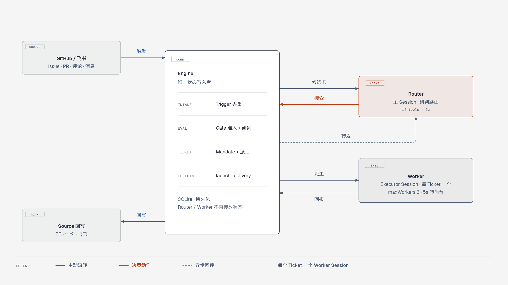](./router-worker-architecture.html)

- 单文件 HTML：[`router-worker-architecture.html`](./router-worker-architecture.html)（内联 SVG，可直接浏览器打开）。
- 阅读方式：Source → Engine → Router → Engine → Worker → Engine → Source 回写；Router 只研判与路由，Worker 每 Ticket 一个，Engine 是唯一状态写入者。
- 图例：实线为主动流转，coral 为决策动作，虚线为异步回传（reportRelay / notice）。
- 画布：`doc-wide` 1280×720；整体版式与三张角色卡片在同一页。

## 图 0b：Agent 协作拓扑（调度 Agent 与 Worker）

[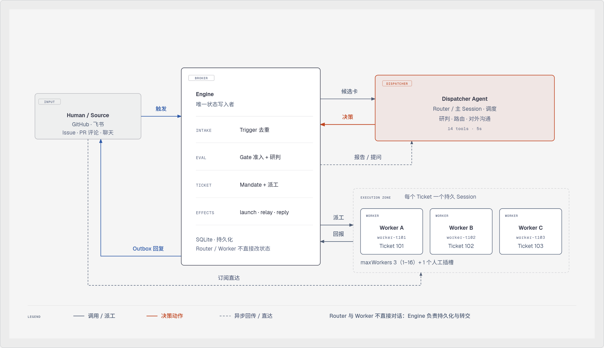](./agent-dispatch-worker.html)

- 单文件 HTML：[`agent-dispatch-worker.html`](./agent-dispatch-worker.html)（内联 SVG + 三张角色卡片）。
- 视角：Dispatcher Agent（Router / 主 Session）在右上，Worker Agents 在右下，Engine 在中间做唯一中转与账本；两者不直接对话。
- 读法：Source → Engine → Dispatcher 决策 → Engine 派工 → Worker → Engine 回报/转提问 → Dispatcher 回复 → Source；已订阅 Thread 的人消息由 Engine 绕过 Router 直达 Worker。
- 画布：`doc-wide` 1280×720；图例：实线调用/派工，coral 决策动作，虚线异步回传/直达。

## 图 0c：当前架构与角色（2026-11-11）

[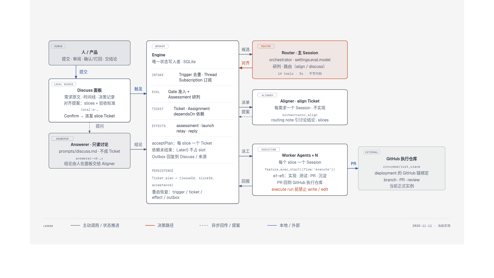](./current-architecture.html)

- 单文件 HTML：[`current-architecture.html`](./current-architecture.html)（内联 SVG + 角色卡 + 角色矩阵 + 实例绑定表）。
- 当前完整链路：Discuss 面板提交需求 → `local` Source 触发 → Router 以 `mode='align'` 接单 → Aligner 提案 slices/验收标准 → 人在面板确认 → Engine `acceptPlan` 每 slice 建一个 Ticket → Worker 先 `feature_exec_start({flow:'execute'})` 再走 e1–e5 → PR 回到 deployment 绑定的 GitHub 仓库。
- 角色：Human（Discuss 审阅/确认）、Router（主 Session，研判路由）、Aligner（align Ticket，只提案）、Worker（work Ticket，执行）、Engine（唯一状态写入者）。
- 注意：本地 issue 目前没有仓库字段，执行仓库来自 deployment 的默认 GitHub 链；页面底部的实例表记录当前正式/测试绑定。
- 这是当前实现的权威总览；图 0 / 0b 保留为早期 Router/Worker 视角。

## 图 1：总体架构与数据流

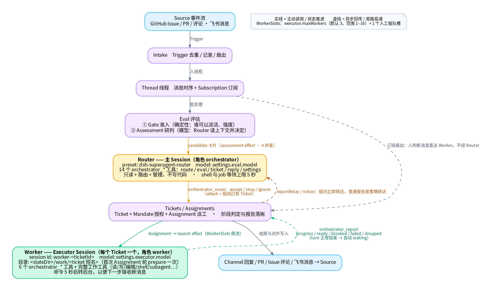

- **Router（主 Session）**：常驻单实例，preset `dsh-superagent-router`，模型 `settings.eval.model`。只负责研判、路由、工单管理与对外沟通；没有文件写入工具，shell 与 job 等待上限 5 秒。
- **Worker（Executor Session）**：每个 Ticket 一个，Session id `worker-<ticketId>`，preset `dsh-superagent-worker`，模型 `settings.executor.model`。独立目录 `<stateDir>/work/<ticket 短名>`，拥有完整工作工具，可开 subagent。
- **Engine**：唯一状态写入者（SQLite Store）。Router 与 Worker 不直接对话，所有状态变更通过 Engine 的领域命令与 `Effects` 持久队列完成。

## 图 2：一张工单的生命周期

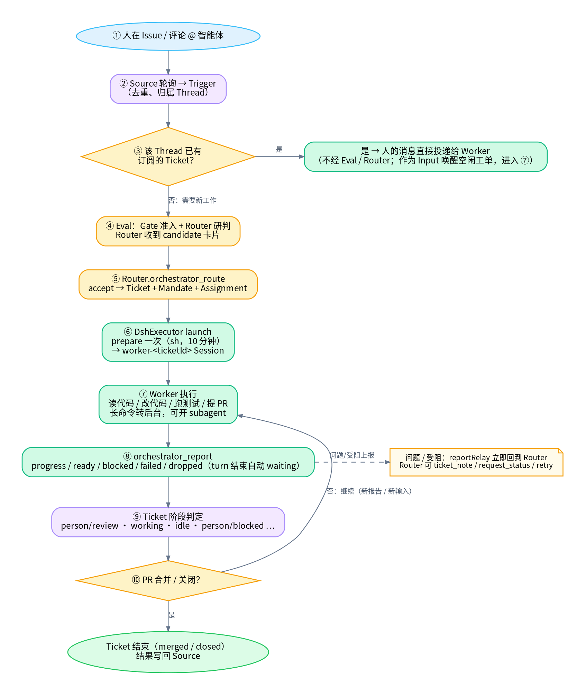

1. 人在 Issue / PR / 评论中 @ 智能体。
2. Source 轮询产生 `Trigger`，按 Thread 去重。
3. 若该 Thread 已有订阅的 Ticket：人的消息直接投递给 Worker（作为 Input，可唤醒空闲工单），**不经过 Router**。否则进入 Eval。
4. Eval = `Gate`（确定性准入）+ `Assessment`（Router 研判）。Router 收到 `candidate` 卡片。
5. `orchestrator_route` 的 `accept` 原子创建 `Ticket + Mandate + Assignment`。
6. `launch` effect 执行 `prepare`（一次，`sh`，10 分钟）并启动/唤醒 `worker-<ticketId>` Session。
7. Worker 在工单目录内工作、提 PR；前台命令 5 秒后转后台，便于下一步接收消息。
8. Worker 调 `orchestrator_report` 上报 `progress / ready / blocked / failed / dropped`；turn 正常结束由 Executor 自动记 `waiting`。
9. `Ticket` 阶段由 `src/core/stage.ts` 判定，如 `person/review`、`working`、`idle`、`person/blocked`。
10. PR 合并/关闭后 Ticket 结束（`merged` / `closed`），结果经 Channel 写回 Source。

## 角色对比

| 维度 | Router（主 Session） | Worker（Executor Session） |
| --- | --- | --- |
| 角色名 | `orchestrator` | `worker` |
| 生命周期 | 进程级常驻，一个实例一个主 Session | 每个 Ticket 一个，Ticket 结束即停 |
| Preset | `dsh-superagent-router` | `dsh-superagent-worker` |
| 模型 | `settings.eval.model` | `settings.executor.model` |
| 工具 | 14 个 `orchestrator_*` + 只读 DSH 工具（`skill/bash/read/read_image/job_*`） | 6 个 `orchestrator_*` + 完整工作工具（读写文件、shell、web、skill、todo、subagent 等） |
| 写入权限 | 无文件写/编辑；只改领域状态与配置 | 可读写工单目录、跑命令、提 PR |
| 等待策略 | shell 与 job 等待 ≤ 5 秒，禁止 `sleep` 轮询 | shell 5 秒后转后台；后台任务/子代理最多 30 分钟 |
| 并发 | 单 Session 串行处理候选卡与消息 | `executor.maxWorkers`（默认 3，范围 1–16）+ 1 个人工插队槽 |
| 主要输出 | `orchestrator_route`、`orchestrator_eval_decide`、`orchestrator_reply` 等 | `orchestrator_report`、PR、Channel 回复 |

## 关键代码位置

- `src/app/sessions.ts:48`：`WORKER_PRESET` / `ROUTER_PRESET` 常量
- `src/app/sessions.ts:150`：`initializeRoleModel(ctx, result.agent, role === 'orchestrator' ? settings.eval.model : settings.executor.model)`
- `src/app/sessions.ts:263`：主 Session 工具白名单 `['skill','bash','read','read_image','job_output','job_list','job_kill']`
- `src/app/sessions.ts:61`：`WORK_TOOLS`（Worker 工作工具集合）
- `src/app/tools/main.ts:127`：`orchestrator_route`（1–20 项，逐项执行）
- `src/app/tools/executor.ts:75`：`orchestrator_report`
- `src/executor/dsh.ts:24`：`workerSessionId = (ticketId) => \`worker-${ticketId}\``
- `src/executor/dsh.ts:177`：`WorkerSlots`
- `docs/003-execution.md:23-29`：Executor 与主 Session 的 preset / 等待限制说明
- `docs/007-architecture.md:491-533`：工具清单与预设说明

## Mermaid 源（与图 1 等价）

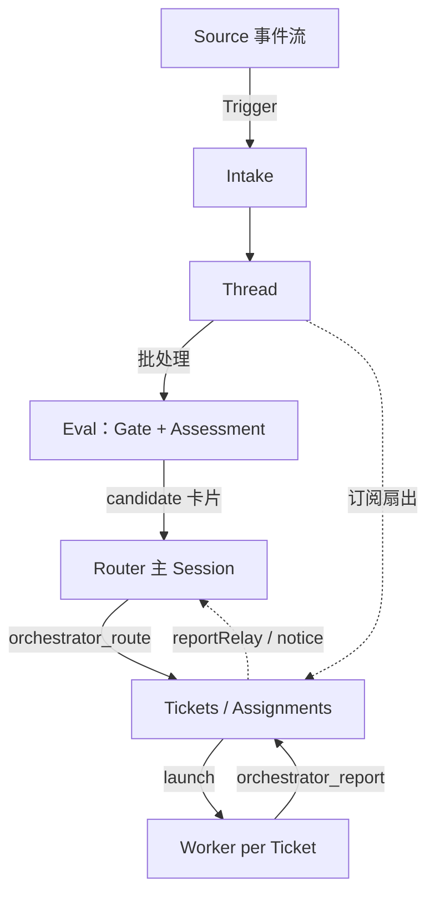

## 图 4：领域模型（001）

[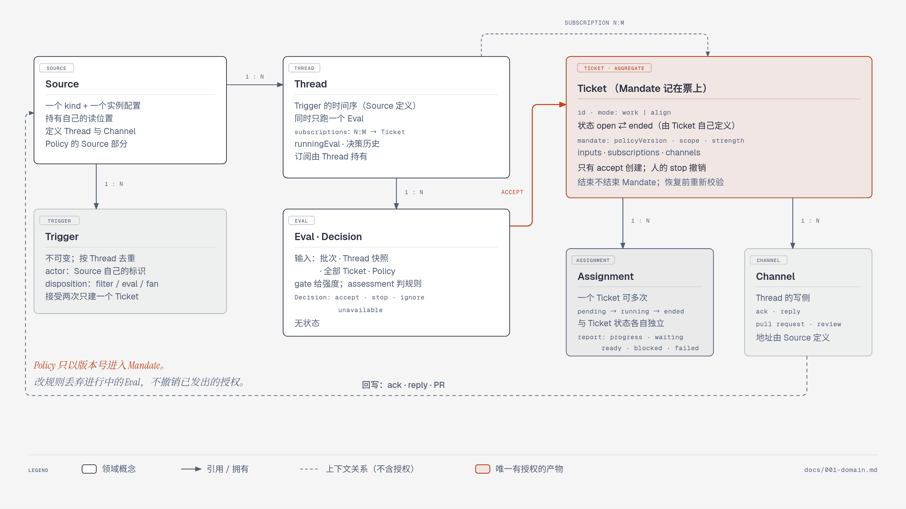](./domain-model.html)

- 七个实体：Source、Trigger、Thread、Eval · Decision、Ticket（Mandate 记在票上）、Assignment、Channel；Subscription 画成 Thread ↔ Ticket 的 N:M 关系。
- 读法：Source → Trigger / Thread → Eval →（accept）Ticket → Assignment，Channel 把 ack / reply / PR 折线回写 Source。
- 关键点：Policy 只以版本号进入 Mandate；订阅扇出只带上下文；Ticket 状态由 Ticket 自己定义，不跟随 Session。

## 图 5：授权流程（002）

[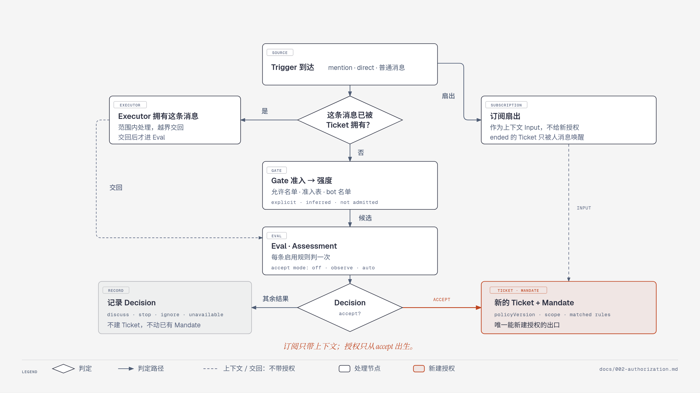](./authorization-flow.html)

- 读法：Trigger 先扇出到订阅的 Ticket（上下文，无授权）；只有没被 Ticket 拥有的消息才进 Gate → Eval → Decision。
- Gate 给三档强度（explicit / inferred / not admitted），accept mode（off / observe / auto）决定推断档能不能成为候选。
- 四种 Decision 里只有 accept 会新建 Ticket + Mandate；其余只记录，不动已有授权。

## 图 6：Ticket 状态机（003）

[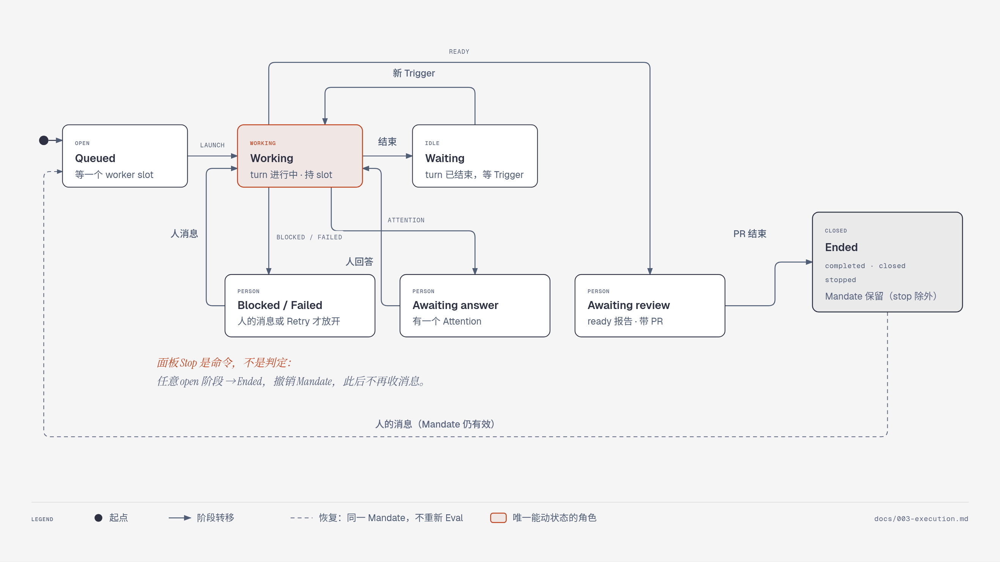](./ticket-state.html)

- 七个阶段：Queued、Working、Waiting、Blocked / Failed、Awaiting answer、Awaiting review、Ended。
- 人回答或写消息会把 Blocked / Awaiting answer 拉回 Working；Ended 只接受人（或面板 attach）的消息，按同一 Mandate 恢复，不重新 Eval。
- 面板 Stop 是命令：任意 open 阶段直接 Ended 并撤销 Mandate；Assignment 的 `pending → running → ended` 是与 Ticket 平行的另一条时间线，见页内卡片。

## 图 7：失败与恢复（003）

[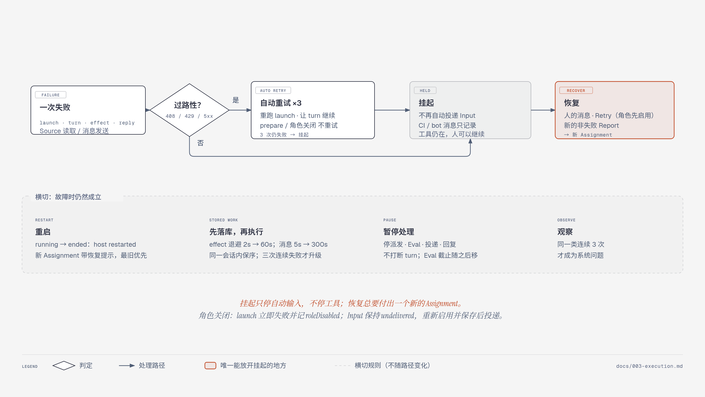](./failure-recovery.html)

- 判定「过路性」：408 / 429 / 5xx、连接被拒或重置、超时；launch 重跑、turn 续跑，**prepare 失败不重试**；三次用尽后挂起。
- 挂起只停自动投递，不停工具；人的消息、Retry 或新的非失败 Report 都会以一个新 Assignment 恢复。
- 横切四条：重启、先落库再执行（effect 2s→60s / 消息 5s→300s）、暂停处理、连续三次失败才升级为系统问题。

## 图 8：部署拓扑（006）

[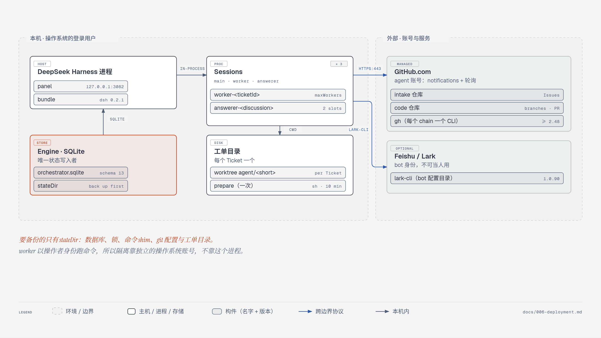](./deployment-topology.html)

- 两个边界：本机（操作系统的登录用户）与外部账号服务；六个节点：进程、SQLite、三类 Session、工单目录、GitHub、可选 Feishu。
- 构件带版本：`panel 127.0.0.1:3082`、`bundle dsh 0.2.1`、`orchestrator.sqlite schema 13`、`gh ≥ 2.48`、`lark-cli 1.0.90`。
- 跨边界两条：`HTTPS:443`（gh / git）与 `lark-cli`；本机内两条：`in-process` 与 `sqlite`、`cwd`。

## 图 9：Agent 能力分层（003 / 005 / 007）

[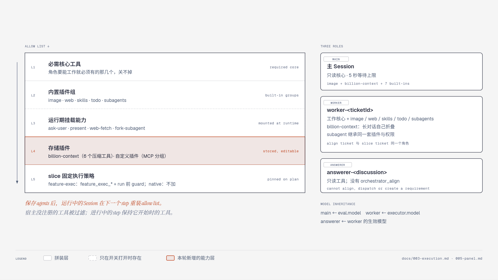](./agent-capabilities.html)

- 五层拼装：必需核心工具 → 内置插件组 → 运行期挂载能力 → 存储插件（billion-context / 自定义）→ slice 固定执行策略。
- 右侧三列是角色默认值：main（只读核心 + image + billion-context）、worker（工作核心 + image/web/skills/todo/subagents + billion-context，subagent 继承）、answerer（只读，无 `orchestrator_align`）。
- 保存 `agents` 后，运行中的 Session 在下一个 step 重装 allow list；宿主没注册的工具被滤掉，进行中的 step 保持原样。

## 图 3：讨论与 Issue 双管线隔离（设计提案，未实施）

[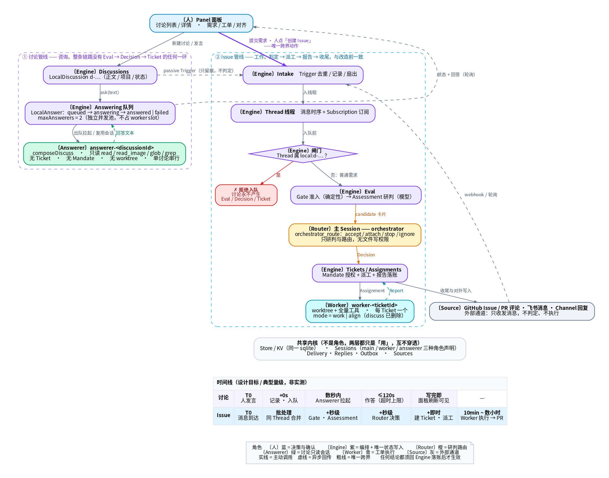](./discussion-issue-isolation.svg)

- 源文件：`discussion-issue-isolation.dot`（Graphviz；`dot -Tpng -Gdpi=130` 渲染）。当前 PNG 2205×1734。
- 背景：讨论（`local:d-…` Thread）目前与需求共用同一条 Engine 管线，讨论里的提问会进 Eval 并被 `kind=ignore`，用户看到的是「没执行」；本图给出隔离后的目标形态。
- 两条管线：① 讨论 = Discussions → Answering 队列 → Answerer（只读会话，无 Ticket/Mandate/worktree，独立并发 `discussions.maxAnswerers`）→ answer 回写面板；② Issue = Intake → Thread → 闸门 → Eval → Router → Tickets → Worker，与改造前一致。
- 闸门：`queueForEval()` 对 `local:d-…` 主 Thread 直接拒绝入队，讨论永不产生 Eval / Decision / Ticket；唯一跨界动作是人在面板点「创建 Issue」。
- 角色色键：〔人〕蓝＝决策与确认、〔Engine〕紫＝编排与唯一状态写入、〔Router〕橙＝研判路由、〔Answerer〕绿＝讨论只读会话、〔Worker〕青＝工单执行、〔Source〕灰＝外部通道。
- 时间线为设计目标 / 典型量级（非实测）：讨论 ≤120s（沿用 `eval.timeoutSeconds`），Issue 判定秒级、Worker 执行 10min～数小时。

## 图 10–20：按文档补齐的第二批（2026-11-15）

这一批按 `docs/000–008` 逐篇补：每篇一条主线，图只讲那条主线，细节留在文档和卡片里。

### 图 10：成对策略轨迹（002）

[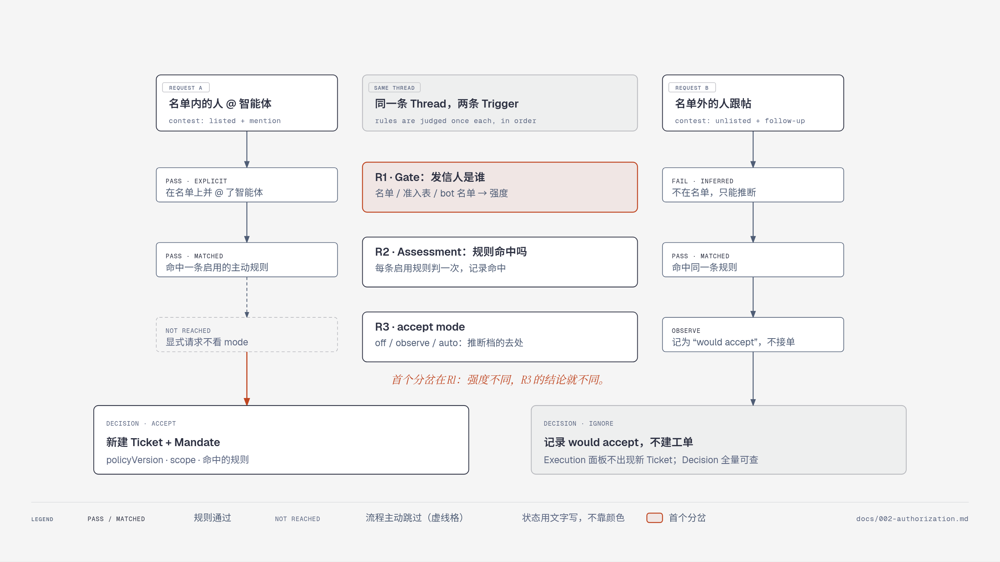](./paired-decisions.html)

- 两条 Trigger、同一套规则、同样的命中结果；差别只在 R1 给出的强度，以及推断档在 `observe` 下只被记录。
- 状态写成 `PASS / FAIL / NOT REACHED` 文本，`NOT REACHED` 用虚线格标出「流程主动跳过」，与 `SKIPPED` 区分。
- 首个分岔用 coral 标在 R1，并有一条注释指出来。

### 图 11 / 12：物理表结构（007）

[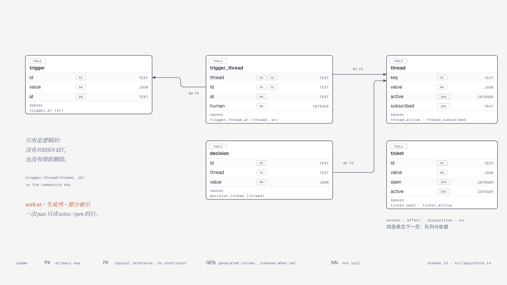](./schema-core.html)
[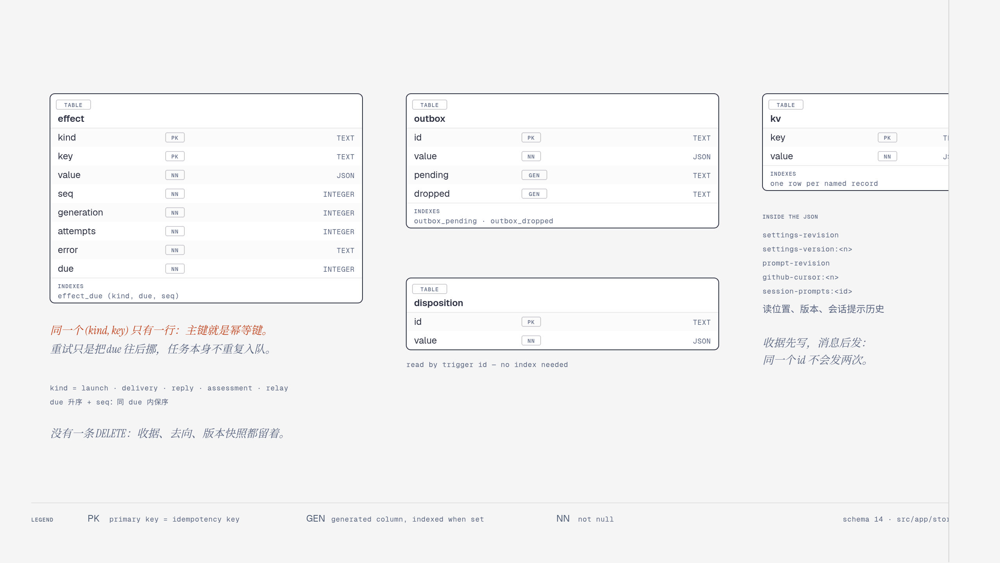](./schema-queues.html)

- 真正的结构是「一列 JSON + 少量生成列」：`trigger` / `trigger_thread` / `thread` / `ticket` / `decision`，以及 `effect` / `outbox` / `disposition` / `kv`。
- 生成列 `active` / `open` / `subscribed` 就是工作集，部分索引只覆盖有活的行。
- 三处逻辑引用没有 `FOREIGN KEY`，也没有级联删除：`no FK` 是图里刻意标出的结论。

### 图 13：模块依赖（007）

[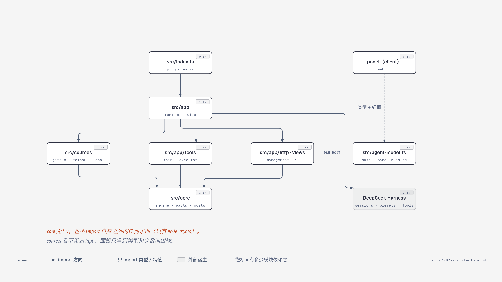](./module-dependencies.html)

- 9 个节点、4 个 rank：`src/core` 扇入 3，且不 import 自身之外的任何东西；`src/sources` 看不见 `src/app`。
- 面板只有一条虚线边到 `agent-model.ts`，表示「类型 + 纯值」。
- 节点右上角的 `N IN` 徽标就是扇入数，用来判断改一处会波及多广。

### 图 14：面板信息架构（005）

[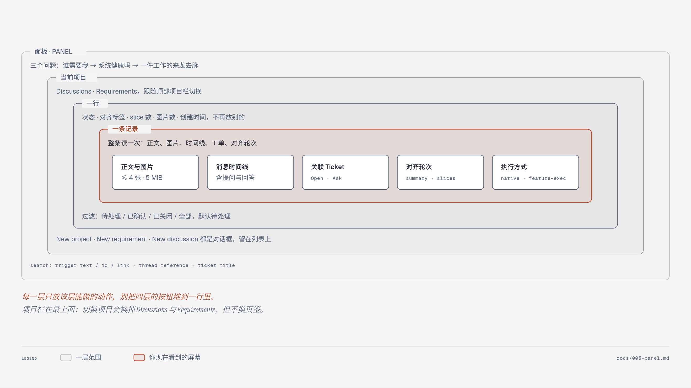](./panel-ia.html)

- 四层嵌套：三个问题 → 当前项目 → 列表一行 → 一条记录；每层只放该层能做的动作。
- 最内层是五块内容：正文与图片、时间线、关联 Ticket、对齐轮次、执行方式。

### 图 15：需求生命周期（005）

[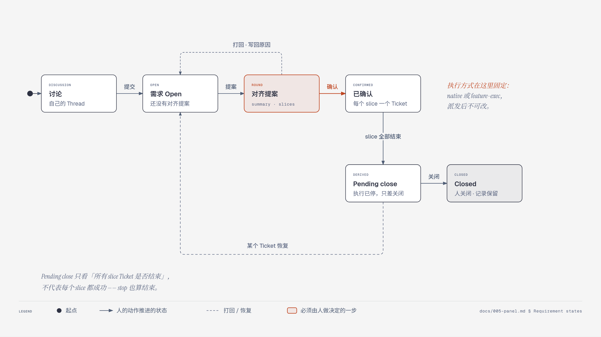](./requirement-lifecycle.html)

- 讨论 →（Send to issue）需求 →（align）提案 →（人确认）已确认 →（slice 全结束）Pending close →（人关闭）Closed。
- 打回回到 Open，Ticket 恢复让标签回到 Open；执行方式在确认时固定，派发后不可改。

### 图 16：新增 Source 的泳道（008）

[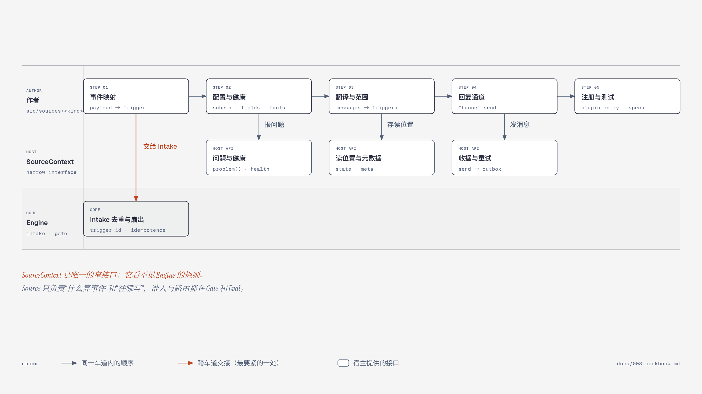](./source-onboarding.html)

- 三条泳道：作者、SourceContext、Engine；作者写五步，其中三处交接给宿主接口，一处交给 Intake。
- 只画八格：去重、准入、重试、工单生命周期都不在作者的职责里。

### 图 17：信任边界（002 / 006 / 007）

[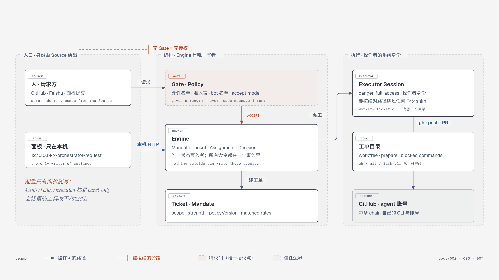](./trust-boundaries.html)

- 请求 → Gate（唯一特权门）→ Mandate → Executor → GitHub；面板只能在本机写配置。
- 两条被拒绝的旁路：绕过 Gate 的请求在边界处停下；会话里的工具改不动设置。
- 图里明说 block 命令与 CLI wrapper 不是安全边界，隔离靠独立的操作系统账号。

### 图 18：并发与排队（003）

[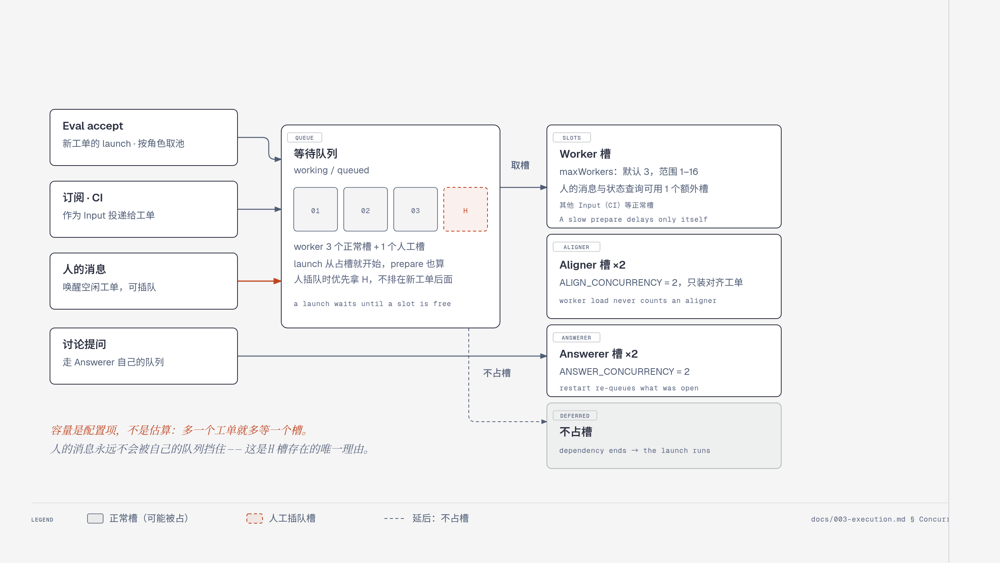](./concurrency-queue.html)

- 三类来源汇入等待队列：新工单、订阅/CI、人的消息；讨论回答走独立的两个 Answerer 槽。
- 槽位画成格子：3 个正常槽 + 1 个人工槽（H），依赖未结束的 slice 不占槽。

### 图 19：提示词拼装（004）

[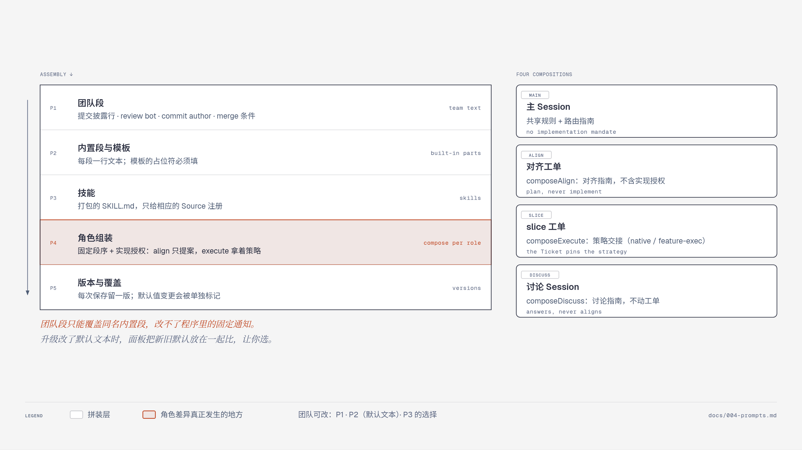](./prompt-assembly.html)

- 五层：团队段 → 内置段与模板 → 技能 → 角色组装 → 版本与覆盖；右列是四份组装结果。
- 角色差异发生在 P4：`composeAlign` 不含实现授权，`composeExecute` 拿着 Ticket 固定的策略。

### 图 20：讨论 → 需求（005）

[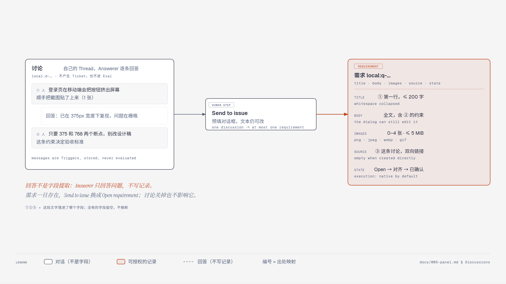](./discussion-to-requirement.html)

- 对话里三条消息与两条回答；人点一次 Send to issue 才发生时态变化。
- 右侧记录五个字段，编号 ①②③ 标出哪段文字落进哪个字段；空字段留空，不推断。
